# Project Genesis

**Data first. Visualization second.**

Project Genesis is a modular simulation engine designed to power complex civilization simulations. This repository contains the complete foundational structure, utilizing a clean, scalable architecture independent of the frontend visualization.

## Project Vision

To build a highly decoupled, data-driven simulation engine where backend systems compute the state of the world, and any number of frontends can connect to visualize that state. This phase focuses entirely on establishing the robust monorepo architecture and foundational packages.

## Architecture

This project follows **Clean Architecture** principles:
- **Presentation:** Frontend React Application.
- **Application:** Use cases and orchestration (Backend Services).
- **Domain:** Core business rules (Shared Types/Models).
- **Infrastructure:** Databases, APIs, and External Services (Backend Repositories).

The simulation engine is completely independent from the frontend.

## Folder Structure

```text
genesis/
├── packages/
│   └── engine/   # Core simulation engine logic (Time Engine, etc.)
├── frontend/     # React, Vite, Tailwind CSS application
├── backend/      # Node.js, Fastify, Prisma backend API
├── shared/       # Shared TypeScript types, interfaces, constants
├── docs/         # Additional project documentation
├── scripts/      # Automation and CI/CD scripts
└── .github/      # GitHub actions and workflows
```

## Tech Stack

### Frontend
- **Framework:** React + TypeScript + Vite
- **Styling:** Tailwind CSS + shadcn/ui
- **State/Routing:** Zustand, React Router, TanStack Query

### Backend
- **Framework:** Node.js + Fastify + TypeScript
- **Database:** Prisma ORM + SQLite
- **Validation:** Zod
- **Config:** dotenv

### Shared
- **Tooling:** ESLint, Prettier, Husky, lint-staged

## Installation

1. Install dependencies from the root to bootstrap all workspaces:
   ```bash
   npm install
   ```
2. Generate the Prisma Client:
   ```bash
   cd backend
   npx prisma generate
   ```

## Running the Project

### Running Backend
```bash
npm run dev:backend
```
*Runs the Fastify server with hot-reload.*

### Running Frontend
```bash
npm run dev:frontend
```
*Runs the Vite development server.*

### Running Both
```bash
npm run dev
```

## Building the Project

To build the entire project (shared, engine, backend, and frontend workspaces) in the correct dependency order:
```bash
npm run build
```

To build individual workspaces:
```bash
npm run build:shared
npm run build:engine
npm run build:backend
npm run build:frontend
```

## Current Phase Status (Phase 7.8.x & Phase 8.x)
- **Completed:** Phase 1 (Core Engine) including Time Engine, Event Scheduler, and Foundation.
- **Completed:** Phase 2 (World Engine) including Environment, Resource, and Spatial engines.
- **Completed:** Phase 3 (Citizen Engine) including Needs, Movement, and Occupation systems.
- **Completed:** Phase 4 (AI Decision Engine) up to Phase 4.5 (Action Execution System).
- **Completed:** Phase 5 (Economy Engine) including Production, Inventory, Supply Chain, and Market.
- **Completed:** Phase 6 (Financial Engine) up to Banking & Loans.
- **Completed:** Phase 7 (Runtime Lifecycle, Persistence, and Economic Intelligence T7.8.1–T7.8.6 & T7.9).
  - T7.8.1: Authoritative Demand Intelligence (`CivilizationDemandService`).
  - T7.8.2: Multi-Stage Supply Intelligence (`CivilizationSupplyService`).
  - T7.8.3: Employment & Income Dynamics (`SalaryService` & Payroll reconciliation).
  - T7.8.4: Market & Price Dynamics (`PriceFormationService` & bounded scarcity/surplus).
  - T7.8.5: Economic Equilibrium & Feedback Integration (production-cost-aware producer reservation pricing & citizen commodity substitution).
  - T7.8.6: Deterministic Long-Run Economic Stability & Final Integration (multi-day cycles, zero money/inventory duplication, Process A → Process B cold restart verification).
  - T7.9: Civilization Simulation Integrity & Roadmap Audit (citizen death and vacancy liberation, spatial coordinate persistence, and living population intelligence aggregation).
- **Completed:** Phase 8 (Visualization & Advanced Economic Dynamics).
  - 8.1–8.6: Spatial Foundation, Canvas Rendering, Live Simulation Synchronization, and Civilization Overview.
  - T8.2: Consumption History & Supply Forecasting (`ConsumptionEngine` persistent ledger, historical demand velocity, and proactive business procurement replenishment).
  - T8.3: Seasonal Agricultural Yield Variation (`AgriculturalYieldCalculator`, deterministic season/weather/temperature curves, zero-yield dormancy, and end-to-end supply-to-market feedback).
  - T8.4: Dynamic Regional Resource Regeneration (`ResourceEngine` periodic recovery curves, renewable capacity clamping, extraction difficulty, and seasonal replenishment).
  - T8.5: Resource Persistence & Conservation (`ResourceRepository` persistence, tick-boundary state sync, and deterministic cold-restart pool restoration).
  - T8.6: Resource-Aware Production & Economic Integration Audit (comprehensive end-to-end trace from agricultural yield calculators and water volumetric unit conversions to B2B procurement and financial ledgers).
  - T8.6.1: B2B Transaction Integrity Restoration (explicit `MarketEngine` dependency injection into `SupplyService` and `BusinessProcurementEngine`, preserving market routing and authoritative ledger creation across `reset()` cycles).
  - T8.6.2: Workplace Financial Persistence (`WorkplaceRepository.updateFinancials()`, authoritative tick-boundary synchronization of `revenue`, `expenses`, `profit`, and accounting history, with full cold-restart hydration).
  - T8.6.3: Residential Water Infrastructure & Transaction Integrity (residential tap-water access connected to regional resources, exact $1\,\text{m}^3 = 1{,}000\,\text{L}$ conversion, municipal utility tariff billing, persistent idempotency across cold restarts, and atomic failure rollback compensation).

## Genesis Roadmap

```text
Phase 1 ✅ Core Engine
├── Project Foundation
├── Time Engine
├── Event Scheduler
└── Engine Inspector

Phase 2 ✅ World Engine
├── 2.1 World Model
├── 2.2 Environment Engine
├── 2.3 Resource Engine
├── 2.4 Spatial Engine
└── 2.5 World Inspector

Phase 3 ✅ Citizen Engine
├── 3.1 Citizen Model
├── 3.3 Needs & Vital State
├── 3.4 Location, Routes & Movement
└── 3.5 Occupation, Skills & Workplaces

Phase 4 ✅ AI Decision Engine
├── 4.1 AI Decision Framework
├── 4.2 Perception System
├── 4.3 Need → Action System
├── 4.4 Utility & Priority System
└── 4.5 Action Execution System

Phase 5 ✅ Economy Engine
├── 5.1 Production Definitions & Engine
├── 5.2 Inventory System
├── 5.3 Supply Chain & Procurement
└── 5.4 Market & Consumer Purchasing

Phase 6 ✅ Financial Engine & Advanced Economy
├── 6.1 Wallets & Transaction Ledger
├── 6.2 Salary & Employment Economy
├── 6.3 Business Accounting
├── 6.x-1 Production Costing & Supplier Quality
├── 6.4 Banking & Loans
└── 6.5 Macro Economics & Taxes (Planned)

Phase 7 ✅ Runtime Lifecycle, Persistence & Economic Dynamics
├── 7.1 Database Bootstrap
├── 7.2 Backend Data Hydration
├── 7.3 Runtime Lifecycle & Safe Shutdown
├── 7.8.1 Authoritative Demand Intelligence
├── 7.8.2 Multi-Stage Supply Intelligence
├── 7.8.3 Employment & Income Dynamics
├── 7.8.4 Market & Price Dynamics
├── 7.8.5 Economic Equilibrium & Closed Feedback Loop
├── 7.8.6 Long-Run Economic Stability & Final Integration
└── 7.9 Civilization Simulation Integrity & Roadmap Audit

Phase 8 ✅ Visualization & Advanced Economic Dynamics
├── 8.1 Spatial Foundation & World Renderer
├── 8.2 Settlement & City Visualization
├── 8.3 Natural World & Resource Visualization
├── 8.4 Citizen Movement & Action Visualization
├── 8.5 Live Simulation Synchronization
├── 8.6 Civilization Overview & Metrics Exposure
├── T8.2 Consumption History & Supply Forecasting
├── T8.3 Seasonal Agricultural Yield Variation
├── T8.4 Dynamic Resource Regeneration
├── T8.5 Resource Persistence & Conservation
├── T8.6 Economic Integration & Production Audit
├── T8.6.1 B2B Transaction Integrity Restoration
├── T8.6.2 Workplace Financial Persistence
└── T8.6.3 Residential Water Infrastructure & Transaction Integrity

Phase 9 🔜 Social Framework & Relationships
Phase 10 🔜 Optimization & Scale
```

## Implementation Status Matrix

| System | Status | Notes |
|---|---|---|
| Time Engine | ✅ Implemented | Drives global simulation clock |
| World Engine | ✅ Implemented | Authoritative spatial and regional data |
| Citizen Engine | ✅ Implemented | Needs, movement, and occupations |
| Decision Engine | ✅ Implemented | Analyzes needs, generates candidates, and evaluates substitutes |
| Production | ✅ Implemented | Data-driven production cycles, dynamic costing, and worker efficiency |
| Seasonal Agriculture | ✅ Implemented | Deterministic climate, season, weather, soil, and water crop yield calculation |
| Consumption History & Forecasting | ✅ Implemented | Persistent consumption ledger, demand forecasting, and proactive procurement |
| Inventory | ✅ Implemented | Producers/Businesses store and manage goods |
| Procurement | ✅ Implemented | Automated business procurement thresholds and bulk pricing |
| Wholesale | ✅ Implemented | Wholesale ordering, supplier ranking, and producer cost floors |
| Retail | ✅ Implemented | Consumer-facing stock and dynamic scarcity/surplus pricing |
| Shipments | ✅ Implemented | Physical/spatial transfer of ordered goods |
| Citizen Purchases | ✅ Implemented | Consumers buy goods to fulfill needs with price sensitivity |
| Commodity Substitution | ✅ Implemented | Affordability-aware substitution across equivalent commodities |
| Market & Pricing | ✅ Implemented | Bounded supply-demand pricing (`PriceFormationService`) |
| Financial Engine | ✅ Implemented | Core financial rules, cost, and transactions |
| Salary & Payroll | ✅ Implemented | Payroll with skill, risk, performance modifiers, and debt recovery |
| Business Accounting | ✅ Implemented | Tracks business revenue, expenses, and P/L |
| Production Costing | ✅ Implemented | Dynamic labor and resource input costs |
| Producer Reservation Pricing | ✅ Implemented | Production-cost-aware wholesale pricing floor |
| Supplier Quality | ✅ Implemented | Dynamic quality tracking and ranking |
| Banking & Loans | ✅ Implemented | Core banking, credit scores, and EMI processing |
| Civilization Intelligence | ✅ Implemented | Authoritative live demand, supply, employment, and market metrics |
| Resource Regeneration & Conservation | ✅ Implemented | Natural regeneration, capacity clamping, extraction difficulty, and authoritative SQLite persistence |
| B2B Transaction Pipeline | ✅ Implemented | Authoritative market routing, wholesale pricing, and transaction ledger persistence across resets |
| Workplace Financial Persistence | ✅ Implemented | Authoritative snapshot sync of workplace revenue, expenses, and profit to SQLite |
| Residential Water & Utility Infrastructure | ✅ Implemented | Piped tap water access, regional resource conservation, domestic tariff billing, restart idempotency, and atomic compensation |
| Taxes | 🔴 Not implemented | Slated for future phase |
| Spatial Renderer | ✅ Implemented | Canvas-based rendering of the world |
| Live Simulation UI | ✅ Implemented | Real-time visualization of citizens and environment |
| Civilization Overview | ✅ Implemented | Aggregated dashboard for economy, supply, demand, and prices |

## Phase 2 – World Engine

The World Engine provides the spatial foundation for every future module in Project Genesis. 

### Responsibilities
- Manages the hierarchical spatial structure of the simulation world.
- Serves as the authoritative source for the location of all simulated entities.
- Provides high-performance spatial queries (e.g. `findNearbyBuildings`, `findNearestEntity`).

### Hierarchy & Spatial Model
The simulation environment is organized into a strictly parented tree structure:
`World` -> `Region` -> `City` -> `District` -> `Building` -> `Room` -> `Object`

Every spatial entity maintains a 2D Cartesian `Coordinate (x, y)` to allow euclidean distance calculations and pathfinding.

### Future Integration
All future engines (Citizen, Weather, Economy, Transportation, AI) will depend on the World Engine to situate their domain entities and resolve spatial interactions.

### Overall Genesis Architecture

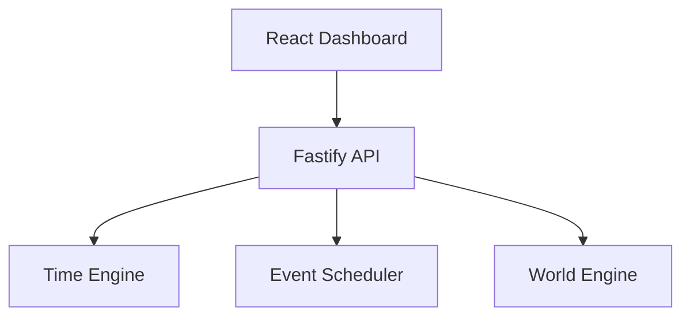
## World Initialization

Genesis does not automatically create a simulation world.

On first startup:

1. No active world exists.
2. GET /api/v1/world returns **404 No Active World**.
3. The frontend displays a "Create World" state.
4. The developer creates the world using:

POST /api/v1/world

After creation, the World Engine becomes active and all future modules operate within this world.

This design ensures the simulation lifecycle is explicit and controlled by the engine rather than hidden initialization logic.

## Phase 2.2 – Environment Engine

The Environment Engine adds a robust, data-driven environmental simulation layer to Genesis. It is responsible for simulating realistic environmental conditions across the world's regions independently from other engines.

### Architecture
The Environment Engine comprises independent modules to maintain separation of responsibilities:
- **Climate Manager**: Stores Region "DNA" (Tropical, Temperate, etc.)
- **Season Manager**: Dictates seasons (Spring, Summer, Autumn, Winter) mapped to the Genesis calendar.
- **Day Cycle Manager**: Translates time into day phases (Dawn, Morning, Afternoon, Evening, Night).
- **Weather Manager**: Handles localized weather transitions using weighted probabilities and Markov chains.
- **Environment Calculator**: Dynamically calculates granular values (Temperature, Humidity, Wind, Visibility) based on base climate, season, day phase, weather, and noise.

### Event Integration
The Environment Engine avoids tight polling. Instead, it subscribes to the Event Scheduler (using a recurring hourly event) to update states and emits standard `SimulationEvent`s when seasons, weather, or day phases transition (e.g., Sunrise, Sunset, Season Change).

### Weather Fronts and Spatial Coherence
Adjacent regions influence each other. A storm in one region can bleed into a neighboring sunny region, creating realistic weather fronts moving across the world without relying on pure randomness.

### Mermaid Diagrams

#### Engine Integration
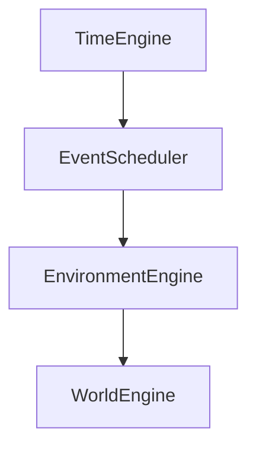

#### Environment Engine Architecture
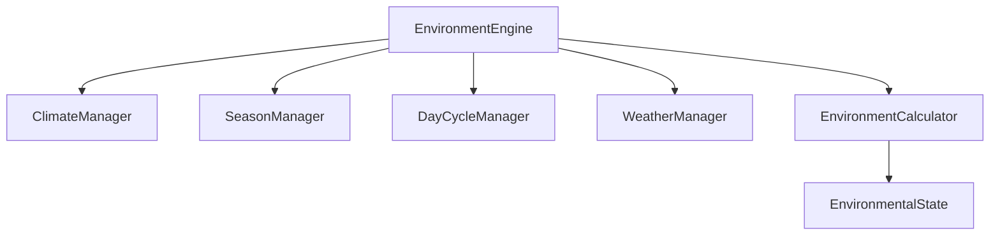

#### Calculation Flow
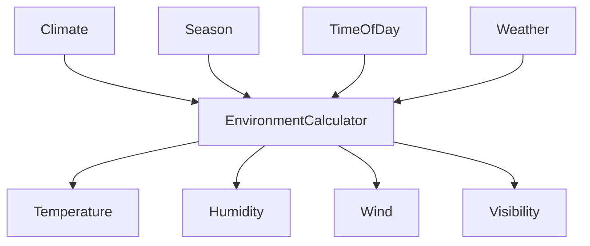

#### Spatial Coherence (Weather Propagation)
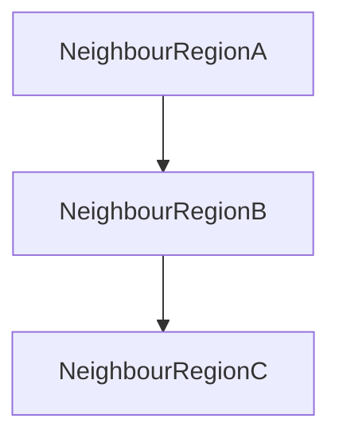

## Phase 2.3 – Resource Engine

The Resource Engine represents nature in Project Genesis. It is responsible for generating, storing, managing, regenerating, and monitoring every natural resource existing in the simulation world. Resources exist independently of civilization, and their generation is strictly deterministic based on the World Seed.

### Purpose
To provide a foundational, data-driven layer of natural resources (Water, Forests, Minerals, Energy Potentials) that future economic and citizen systems will interact with.

### Architecture
The Resource Engine is highly modular and integrates seamlessly with existing systems while remaining decoupled:
- **ResourceManager**: In-memory state store for all resources.
- **ResourceGenerator**: Deterministic generation algorithms seeded by the World Seed and Region factors.
- **ResourceCalculator**: Formulas for dynamic resource evolution based on environmental states.

### Generation Pipeline
Resource generation strictly follows a dependency chain ensuring absolute determinism:

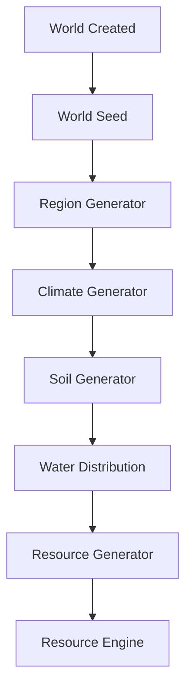

### Static vs Dynamic Factors
- **Static Factors**: Define the initial generation based purely on Region characteristics (Climate, Seed). E.g., Mountains have High Stone and Iron, Deserts have Low Water but High Solar Potential.
- **Dynamic Factors**: Modifies existing resources post-generation. Governed by Weather, Season, Temperature, and Humidity.

### Regeneration
- **Renewable Resources**: (Water, Forests, Wildlife, Fish) Regenerate over time driven by environmental inputs.
- **Non-Renewable Resources**: (Iron, Coal, Gold, Oil) Never regenerate.

### Environmental Interaction
The Resource Engine subscribes to the Event Scheduler and updates based on the authoritative Environmental state. Heavy rain increases river levels and forest growth, while heatwaves cause drought damage to biological resources.

#### Engine Integration
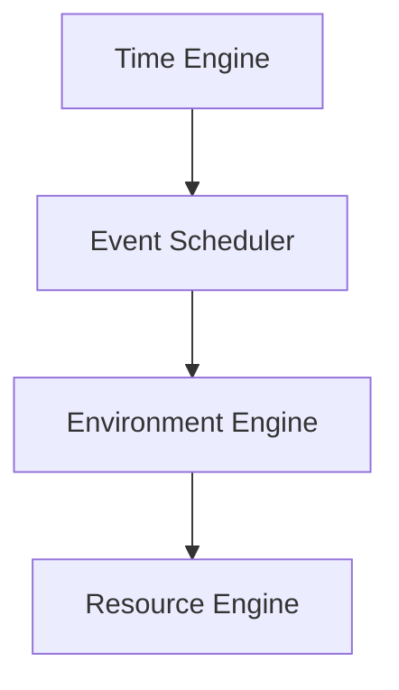

#### Regional Resource Model
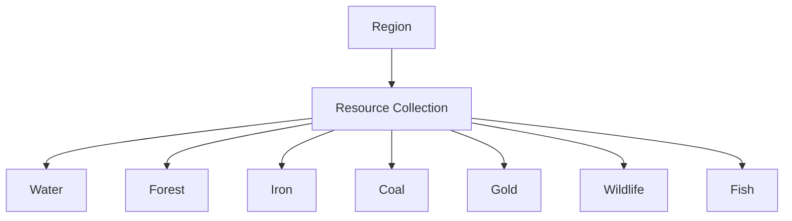

#### Dynamic Update Flow
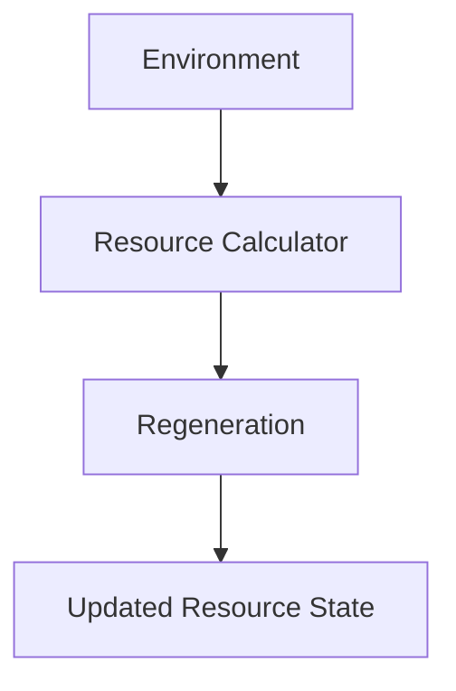

## Phase 2.4 – Spatial Engine

The Spatial Engine provides efficient spatial queries, indexing, and coordinate relationships over the world managed by the World Engine. It does not replace the World Engine's hierarchical ownership, but answers "How are these entities spatially related?" in a performant manner.

### Purpose
To serve high-performance spatial queries (e.g. `findNearby`, `findNearest`) avoiding O(N) entity scans across the entire simulation by utilizing a generic Spatial Index.

### Coordinate System
All entities in the World Engine use a 2D Cartesian coordinate system. The Spatial Engine uses deterministic Euclidean distance: `sqrt((x2 - x1)^2 + (y2 - y1)^2)`.

### Spatial Index (GridSpatialIndex)
A generic `SpatialIndex` interface abstracts the storage mechanism. The current implementation uses a **Spatial Hash Grid**, splitting the world into discrete cells. When a query is performed, only entities residing in intersecting cells are inspected, drastically improving performance.

### Entity Lifecycle and Event Integration
When entities are created, moved, or removed in the World Engine, the Spatial Engine reacts to update its index dynamically, ensuring stale data is purged.

### Engine Integration
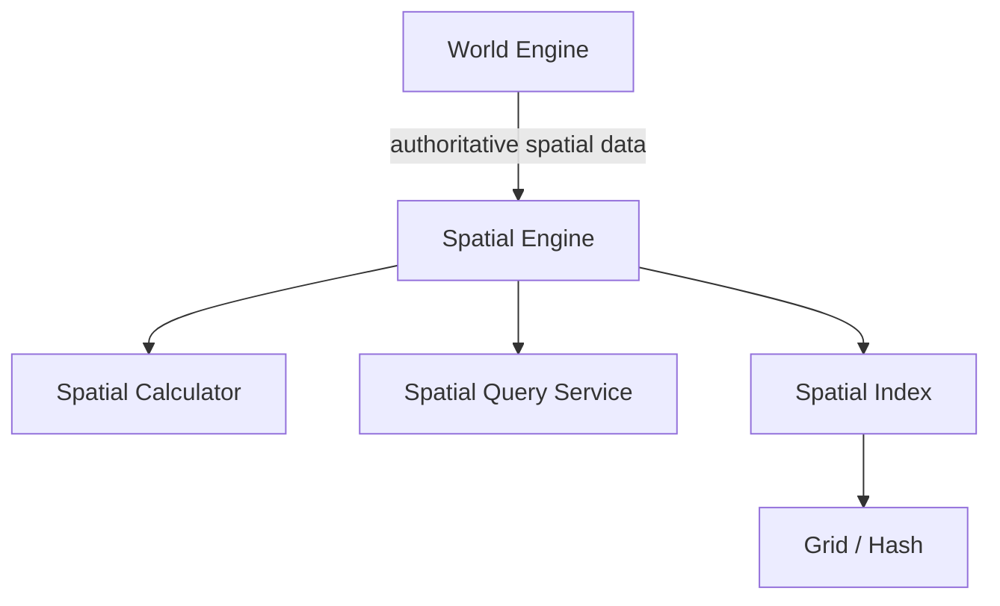

### Entity Lifecycle
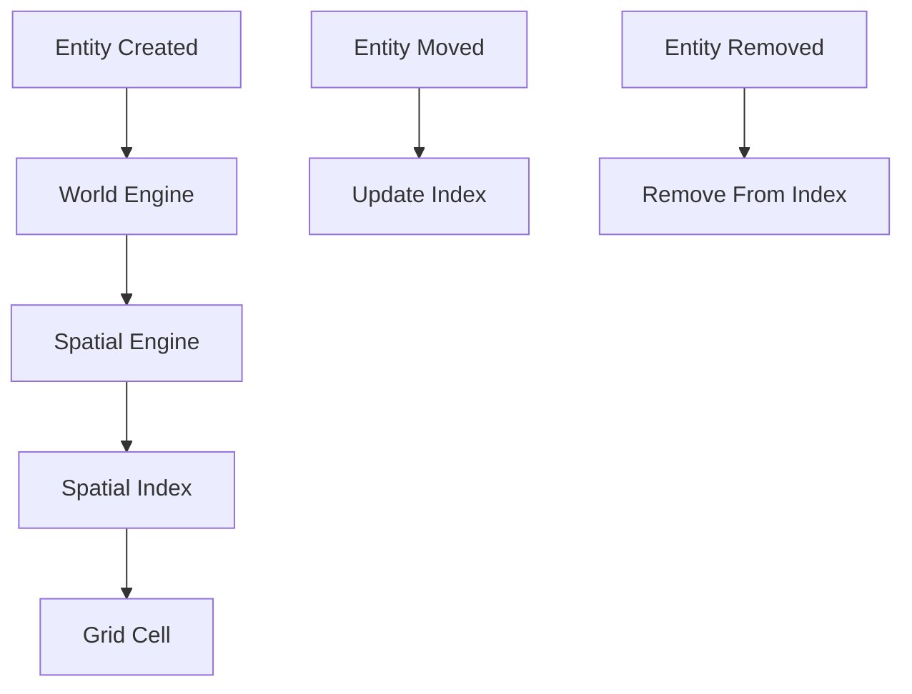

### Spatial Query Flow
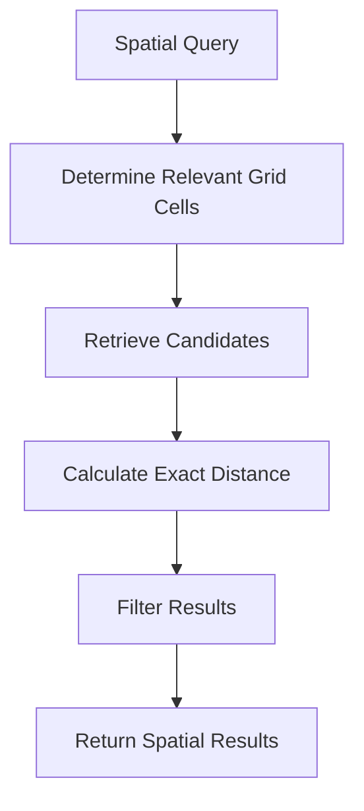

## Phase 2.5 — World Inspector

The World Inspector is a **Read-Only developer interface** designed to observe the live, deterministic state of the entire Genesis simulation. It acts as the ultimate debugging dashboard, aggregating data from all the backend engines into a single, unified view without introducing any simulation logic into the frontend.

### Purpose
To provide a data-first, visualization-second view of the simulation, ensuring the backend remains the authoritative source of truth.

### Key Features
- **World Overview**: Real-time simulation time, season, world seed, and entity counts.
- **Hierarchical World Tree**: Expandable mapping of Regions, Cities, Districts, and Buildings directly from the backend.
- **Entity Inspector**: Displays environmental data (climate, weather, temp), regional resources (capacity, quantity, regeneration rate), and spatial coordinates.
- **Engine Statuses**: Tracks the health, uptime, and queue states of Time, Events, World, Environment, Resource, and Spatial engines.
- **World Verification**: Calculates a deterministic SHA-256 hash derived purely from structural simulation data, guaranteeing seed-based reproducibility regardless of runtime constraints.

### Read-Only Architecture
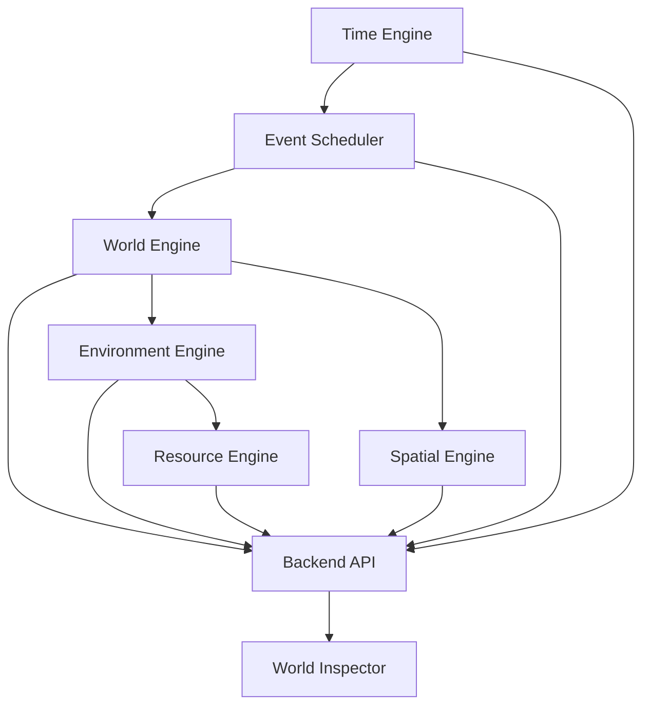

### State Aggregation
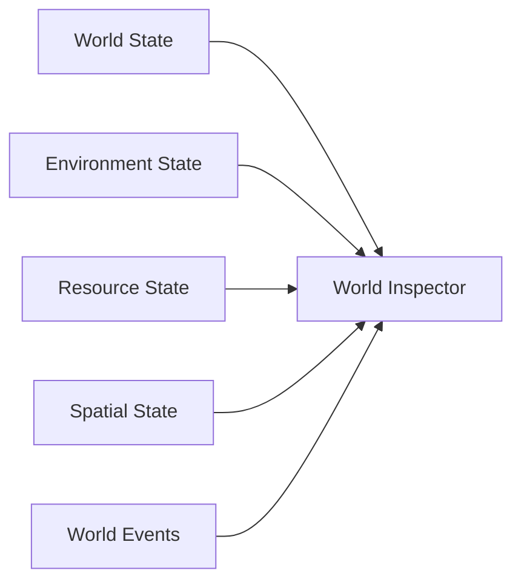

## Phase 3 — Citizen Engine

### Phase 3.1 — Citizen Model
Establishes the foundational deterministic Citizen Domain Model without adding behavior or AI simulation.

- **Purpose**: Define what a Citizen is and provide a clean representation for future systems.
- **Citizen Identity**: Generates unique, stable `citizen-000001` format IDs. Uses deterministic Name Generation powered by `SeededRandom`.
- **Location References**: The engine enforces separation from the World Engine by storing a reference (`locationId`) rather than duplicating spatial data. It explicitly rejects non-existent locations by validating against the authoritative World Engine.
- **Time Integration**: Uses the Time Engine's authoritative `SimulationClock`. Age is deterministically derived via `currentDate.year - birthDate.year` instead of using real-world `Date.now()`.
- **Repository Abstraction**: Includes a clean `CitizenRepository` abstraction with an `InMemoryCitizenRepository` implementation.

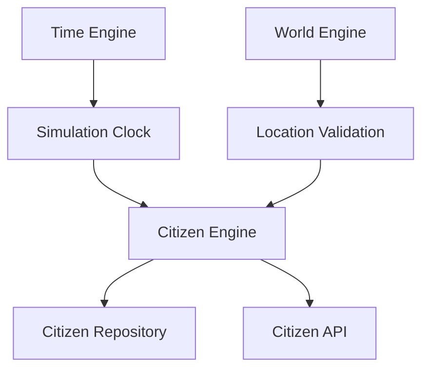

## Phase 3.3 — Needs & Vital State

The Needs & Vital State phase introduces the first dynamic biological state of citizens in Genesis. Each citizen now receives a `VitalState` tracking Hunger, Thirst, Energy, and Health values bounds strictly between 0 and 100.

### Responsibilities
- **Vital State Generation**: Deterministically initializes citizen vital states upon creation using the configured seed.
- **Needs Decay**: Dynamically increases hunger, increases thirst, and modifies energy based strictly on the elapsed Simulation Time between updates.
- **Separation of Concerns**: Health damage and starvation logic belong to future lifecycle modules. Needs Engine strictly manages numerical decay based on time.

### Architecture Rules
- Does **not** use real-world `Date.now()`. Needs decay according to `SimulationClock` time.
- Handles simulation pausing and varying speed gracefully by calculating deltas based on simulation hours elapsed since the last update.
- Scalable: Integrates with the existing `EventScheduler` to run a periodic (hourly) population update rather than spamming independent ticks for thousands of citizens.

### Future Integration
The Needs Engine is structurally ready to interface with the Resource Engine (Food/Water availability) and Environment Engine (Temperature modifiers) through abstractions.

### Engine Architecture

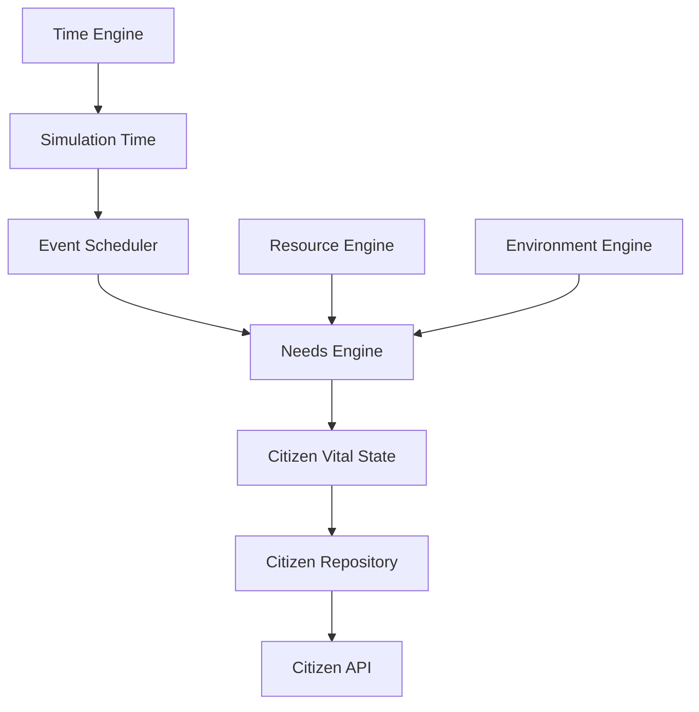

### Future Citizen Lifecycle Dependency

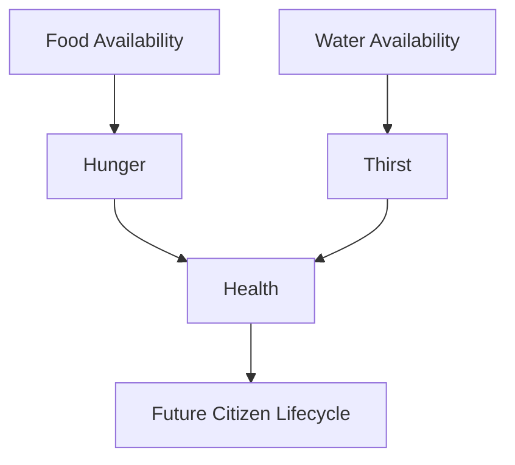

## Resource Model

The Resource Engine strictly defines semantic, deterministic data rather than arbitrary scores.

- **Resource Categories**: Resources are divided into `RENEWABLE` (e.g., Water, Forests) and `NON_RENEWABLE` (e.g., Minerals).
- **Physical Units**: Every resource has a defined physical unit (`m³`, `ha`, `tonnes`, etc.) for absolute clarity.
- **Current Quantity & Capacity**: The engine explicitly limits `currentAmount` to `maximumAmount`, with maximum capacity derived deterministically from region characteristics (climate, size).
- **Natural Recovery**: Renewable resources have a `naturalRecoveryRate` (amount replenished per hour). Non-renewable resources are explicitly marked with `null`.
- **Condition**: Replaces generic "Health" and "Quality" with explicit, semantic strings like `Water Quality`, `Forest Condition`, or `Ore Purity`.
- **Deterministic Generation**: All generation uses a `SeededRandom` dependent on the global world seed and the specific region hash.
- **Consumption**: The API explicitly communicates `consumptionRate`, rendering it as `Not yet simulated` until consumption systems are built.

### Resource Engine Architecture

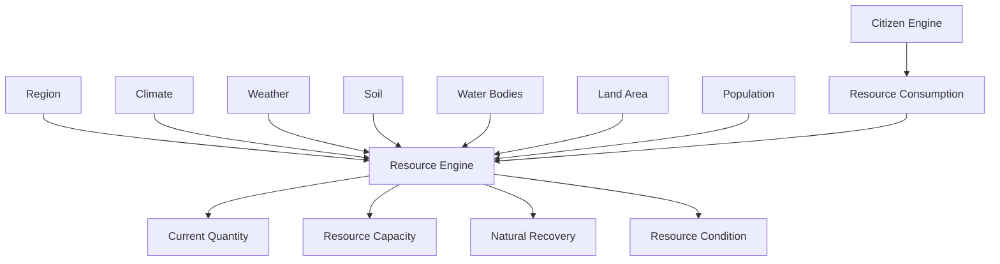

## Phase 3.4 — Location, Routes & Movement

Phase 3.4 introduces the mechanical movement infrastructure for citizens, strictly separating **movement execution** from **movement decision-making**.

### Responsibilities
- **Spatial Validation:** Resolves location IDs to their exact Euclidean coordinates using the World Engine's spatial hierarchies.
- **Route Generation:** Deterministically generates routes and estimated travel durations based on a configurable travel speed.
- **State Management:** Manages the active `MovementState` of citizens (`IDLE` vs `TRAVELLING`) and their active route context.
- **Event-Driven Arrival:** Uses the `EventScheduler` to schedule an arrival event at the expected completion time. Once the event triggers, the citizen's location is atomically updated and they are marked as `IDLE`.

### Movement Flow Architecture

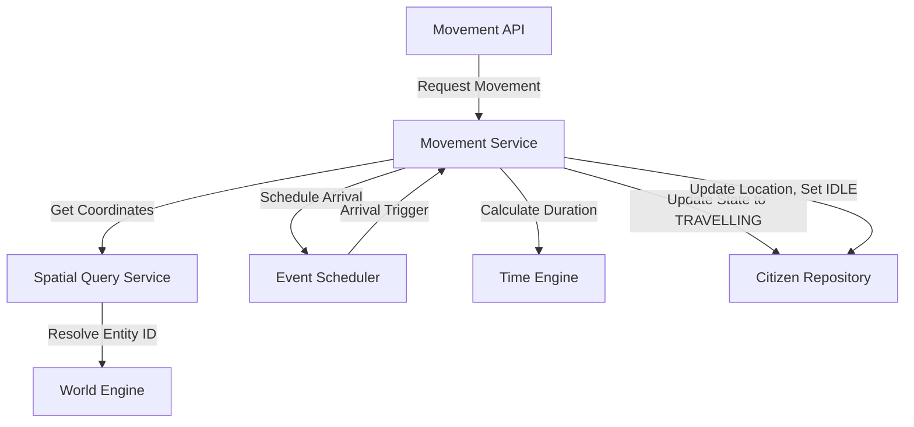

### Determinism and Simulation Speed
Movement respects simulation pausing and dynamic simulation speeds, because the entire system calculates expected arrival in `SimulationTime` terms and integrates with the authoritative Time Engine through the Event Scheduler.

## Phase 3.5 — Occupation, Skills & Workplaces

Phase 3.5 gives citizens an economic and occupational identity. The engine assigns citizens to deterministic, resource-driven workplaces while adhering to strict requirements on skill suitability and age restrictions.

### Responsibilities
- **Skill System:** Citizens are deterministically generated with a set of 0–100 skills depending on their age and seed. 
- **World-Driven Generation:** Workplaces (Farms, Mines, Offices, Public Services) spawn organically based on the world's regions, existing structures (e.g., city buildings), and natural environment rather than randomized assignment.
- **Job Eligibility & Vacancies:** Jobs are strictly distributed based on workplace capacity (`vacancies = capacity - occupiedPositions`), citizen age (under 18 are `STUDENT`, 75+ are `RETIRED`), and required minimum skills.
- **Suitability Ranking:** Unemployed citizens are ranked for vacancies based on skill alignment, resolving tie-breakers deterministically.
- **Work Schedules:** Jobs have intrinsic start and end times, laying the foundation for future routine systems.

### Overall Occupation Architecture

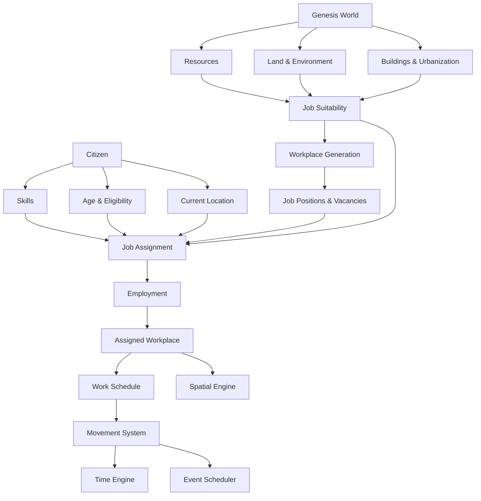

## Phase 4 — AI Decision Engine

The AI Decision Engine provides the foundational framework for citizen intelligence. It strictly separates **decision-making** from **execution**, orchestrating the sequence of perceiving state, scoring options, and finalizing a choice.

### Responsibilities
- **Phase 4.1 (Decision Framework):** Core `DecisionEngine` orchestration, execution, and historical recording.
- **Phase 4.2 (Perception):** `PerceptionService` isolates the citizen's sensory input from raw world data.
- **Phase 4.3 (Need → Action System):** Maps perception and vital state to candidate actions deterministically using `NeedAnalyzer`, `CandidateGenerator`, and `EligibilityFilter`. Does NOT score actions.
- **Scoring:** The engine delegates to a `DecisionEvaluator` that deterministically produces a `[0, 100]` score for candidate actions.
- **Selection:** A `DecisionSelector` selects the highest-scoring action and resolves ties deterministically.
- **Determinism:** The pipeline mathematically maps context inputs to final decisions without randomness, ensuring simulation consistency.
- **Event-Driven & Fallback Decisions:** Citizens evaluate actions triggered by specific events (like needs crossing a threshold or schedules starting) or via periodic fallback checks.
- **Action Execution Boundary:** The chosen `Decision` is passed to an `ActionExecutor`, cleanly handing off side-effects to other engines (Movement, Economy).
- **Decision History:** A bounded `DecisionRecord` log retains recent choices per citizen for inspection and debugging.

### Decision Architecture

```mermaid
flowchart TD

    Citizen[Citizen Engine]
    World[World Engine]
    Environment[Environment Engine]
    Resources[Resource Engine]
    Spatial[Spatial Engine]
    Time[Time Engine]
    Scheduler[Event Scheduler]

    Citizen --> Context[Decision Context]
    World --> Context
    Environment --> Context
    Resources --> Context
    Spatial --> Context
    Time --> Context

    Scheduler --> Trigger[Decision Trigger]

    Context --> Evaluator[Decision Evaluator]
    Trigger --> Evaluator

    Evaluator --> Scoring[0-100 Scoring]
    Scoring --> Selector[Decision Selector]

    Selector --> Decision[Selected Decision]

    Decision --> Executor[Action Executor]

    Executor --> Movement[Movement Engine]
    Executor --> CitizenState[Citizen State]
    Executor --> EconomySystems[Economy / Food / Healthcare]

    Decision --> History[Decision History]
```

## Phase 5 — Economy Engine

The Economy Engine establishes the flow of physical goods through production, storage, procurement, and purchasing.

### Production
The `ProductionEngine` uses data-driven `ProductionDefinitions` to spawn physical goods based on workplace type, worker efficiency, and environmental resource availability.
- **FARM**: Produces `wheat` based on land and water.
- **MINE**: Produces `iron_ore` based on mineral deposits.
- **FISHING_SITE**: Produces `raw_fish` based on marine resources.
- **FOREST_SITE**: Produces `timber` based on forest density.
Production is fully integrated into the `EventScheduler` and updates on simulation-time cycles. Produced goods are directly deposited into the producer's localized inventory.

### Inventory System
The `InventoryManager` provides explicit storage capability, bounding items to defined physical capacities. Goods flow directly from production outputs into inventory allocations, marking ownership and storage location constraints.

### Supply Chain & Procurement
Genesis models physical supply chains utilizing the `BusinessProcurementEngine` and `SupplyChainEngine`.
- **Procurement Automation:** Retail and wholesale locations actively monitor their inventory thresholds. When stock drops below a configurable reorder point, the engine generates restock requirements.
- **Supplier Selection:** Businesses discover producers and wholesalers via the `MarketEngine`, ranking them based on distance, price, available stock, and dynamic product quality.
- **Shipments:** Instead of instantly teleporting goods, physical `Shipment`s are scheduled and processed based on spatial distance and speed.
- **Citizen Purchasing:** Individual citizens seek out retail centers to fulfill needs, engaging the `PurchaseActionExecutor` to buy inventory directly from shelves.

## Phase 6 — Financial Engine & Advanced Economy

The Financial Engine sits parallel to the physical Economy Engine, translating the movement of goods and labor into distinct, balanced monetary ledgers.

### Core Systems
- **Wallets:** Every business and citizen possesses an explicit `Wallet` maintaining a balance in GEN (or INR equivalent) currency.
- **Market & Transactions:** The `MarketEngine` serves as the clearinghouse for transactions, atomically debiting buyers, crediting sellers, and enforcing liquidity requirements.
- **Salary System:** `SalaryService` calculates individual citizen compensation via base job rates, risk multipliers, skill suitability, attendance records, and performance scores.
- **Business Accounting:** The `BusinessAccounting` service tracks comprehensive revenue, operational expenses, and resulting Profit/Loss statements for independent enterprise entities.
- **Financial Ledger:** The `TransactionLedger` writes immutable double-entry style records of all simulated monetary transfers.

### Phase 6.x-1: Production Costing & Supplier Quality
Genesis has recently refactored hardcoded assumptions out of the financial simulation.
- **Dynamic Production Costing:** The `ProductionCostCalculator` evaluates exact real-time costs during daily production events. It pulls true labor costs directly from the central salary logic (dividing monthly wages by 30) and calculates resource input costs using a `ResourceValuationConfig`. 
- **Cost Per Unit:** The engine computes the absolute total cost and dynamic cost-per-unit for production runs, logging it to business accounting while safely handling edge cases (e.g., zero production avoiding division-by-zero errors).
- **Dynamic Supplier Quality:** The `BusinessProcurementEngine` ranks suppliers using the actual `quality` (0-100) property intrinsically attached to `InventoryItem` records. Uninitialized or legacy items default to a neutral `50` fallback.

### Phase 6.4: Banking & Loans
The Banking & Loans system introduces credit markets and money creation to the Genesis simulation.
- **Bank Operations & Ledger Management:** Supports core fractional-reserve banking operations including deposits, withdrawals, and inter-bank transfers. Banks manage their own capital, reserves, and track total deposits versus total loans issued.
- **Credit Scoring:** A deterministic `CreditScoreCalculator` evaluates and tracks credit histories for borrowers. Scores dynamically update based on loan approvals, timely EMI payments, missed payments, defaults, and loan payoffs.
- **Dynamic Lending & Eligibility:** Citizens and businesses can apply for loans. The `LoanCalculatorFactory` evaluates financial inputs against configurable loan types to determine eligibility and approve amounts. Approvals are dynamically capped by the bank's active lending capacity via the `LendingCapacityCalculator`, strictly respecting reserve ratio rules.
- **Automated EMI Processing:** The `BankingEngine` schedules automated monthly EMI processing via the `EventScheduler`. It calculates principal and interest portions, automatically deducts payments from wallets, updates credit scores, and manages loan states (e.g., ACTIVE, PAST_DUE, DEFAULTED, PAID_OFF) upon missed payments.
- **Money Creation:** When loans are approved, the bank credits the borrower's wallet, dynamically creating money in the broader economy while maintaining strict double-entry balance sheets tracking the loan asset against deposit liabilities.

## Phase 7 — Runtime Lifecycle, Persistence & Macroeconomic Dynamics

Phase 7 bridges the discrete packages of Project Genesis into a persistent, orchestrated simulation runtime driven by live data, authoritative macroeconomic intelligence, and equilibrium feedback loops.

### Runtime Lifecycle & Persistence (7.1 – 7.3)
- **Database Schema & ORM:** Uses Prisma ORM with SQLite for persistent local simulation states across worlds, regions, entities, businesses, bank accounts, loans, citizens, and inventories.
- **Backend Hydration & Repositories:** Repository pattern wrappers (`CitizenRepository`, `BusinessRepository`, `WorldRepository`, `MarketRepository`) hydrate in-memory engine objects with database integrity checks.
- **Engine Lifecycle Orchestrator:** Manages non-blocking simulation loops, event queue synchronization, speed throttling, and safe database checkpoints upon suspension or shutdown.

### Authoritative Demand Intelligence (7.8.1)
The `CivilizationDemandService` calculates authoritative societal consumption and needs without synthetic or randomized injection:
- **Vital Need Translation:** Translates living citizens' unmet physiological states (e.g., Hunger > 40 $\to$ `wheat`, `raw_fish`) directly into daily calorie demand.
- **Real Historical Consumption:** Derives active transaction velocity from the `TransactionLedger` to measure actual cleared consumption.
- **Unmet Deficit Tracking:** Quantifies unsatisfied demand across food, raw materials, and manufactured goods to surface regional scarcity.

### Multi-Stage Supply Intelligence (7.8.2)
The `CivilizationSupplyService` inspects the multi-tier production and distribution pipeline across the world:
- **Raw Resource Reserves:** Tracks unextracted regional deposits (forests, mineral veins, water, agricultural fertility).
- **Producer Capacity Yield:** Measures daily throughput capabilities of active production facilities (farms, mines, lumber mills) based on workforce staffing.
- **Finished Inventory:** Aggregates ready-to-sell stock in retail shelves and wholesale warehouses via `InventoryManager`.
- **Transit Volume:** Audits physical `Shipment` objects currently moving across road networks.

### Employment & Income Dynamics (7.8.3)
The `SalaryService` and employment pipelines calculate realistic income distribution:
- **Wage Determination:** Computes individual compensation based on base occupation scales, skill suitability ratings, workplace hazard/risk multipliers, attendance ratios, and performance evaluations.
- **Payroll Solvency & Reconciliation:** Scheduled pay cycles debit business treasury wallets to credit citizen wallets, respecting employer liquidity and banking reserve constraints.
- **Bank Debt Recovery Priority:** Automated monthly EMI deduction intercepts payroll income to service outstanding bank loans, dynamically adjusting credit scores.

### Market & Price Dynamics (7.8.4)
The `PriceFormationService` replaces static prices with a supply-demand formation model:
- **Scarcity / Surplus Curve:** Modulates baseline reference prices using bounded market pressures:
  $$\text{Multiplier} = \text{clamp}\left(1 + \alpha \cdot \frac{\text{Demand} - \text{Supply}}{\max(\text{Demand}, \text{Supply}, 1)}, 0.5, 2.5\right)$$
  ensuring prices fluctuate smoothly between 50% (severe glut) and 250% (extreme scarcity) without hyperinflationary runaways.
- **Regional & Landed Modifiers:** Applies spatial friction, terrain modifiers, and transportation distance costs to calculate accurate landed purchase prices.
- **Wholesale Bulk Discounts:** Incorporates volume tiers where wholesale procurement receives lower unit pricing compared to retail consumer counters.

### Closed Economic Equilibrium & Feedback Integration (7.8.5)
Connects all economic subsystems into an autonomous, closed feedback loop:
- **Producer Reservation Pricing Floor:** Producers refuse to sell below dynamic production costs:
  $$P_{\text{reservation}} = \text{Unit Cost} \times (1 + \text{Target Margin})$$
  Live labor expenses from `SalaryService` and material resource costs from `ProductionCostCalculator` dynamically set the wholesale price floor.
- **Affordability-Aware Commodity Substitution:** The AI decision system (`CandidateGenerator`, `HardConstraintFilter`, `PersonalityUtilityEvaluator`) identifies interchangeable consumable commodities (e.g., `wheat` vs `raw_fish`). When a preferred staple becomes scarce or expensive, budget-constrained citizens automatically substitute more affordable alternatives.

---

## Phase 8 — Visualization & UI Architecture

Genesis features an integrated, real-time visualization layer designed to inspect macroeconomic and spatial states without polluting engine purity.

### Spatial Engine & World Canvas (8.1 – 8.3)
- **High-Performance Canvas Renderer:** Renders terrain grids, elevation contours, moisture maps, and natural resource clusters using hardware-accelerated 2D canvas drawing.
- **Interactive Viewport:** Smooth zooming, panning, tile coordinate inspection, and layer toggle filters (Resource Density, Biomes, Settlement Boundaries).
- **Settlement & Infrastructure Rendering:** Displays architectural blueprints, building footprints, storage warehouses, and connecting transit corridors.

### Citizen & Logistics Tracking (8.4 – 8.5)
- **Agent Movement Interpolation:** Visualizes real-time citizen movement, active path trajectories, commuting routes, and vital state indicators (Hunger, Health, Energy).
- **Logistics & Shipment Visualization:** Depicts freight shipments in transit between extraction sites, wholesale distribution hubs, and retail stores.
- **Simulation Control Panel:** Full control over `TimeEngine` with real-time speed controls (1x, 5x, 10x, 60x), play/pause toggles, and tick-synchronized event monitors.

### Civilization Overview Dashboard (8.6)
- **Macroeconomic Telemetry:** Surfaces authoritative macro indicators via `/api/v1/world/summary` and `/api/v1/market/prices`.
- **Live Commodity Pricing:** Renders real-time retail and wholesale price tables in Indian Rupees (₹ / INR), highlighting daily price shifts, inflation, and scarcity indexes.
- **Supply & Demand Balances:** Visual comparison between production yields, citizen consumption rates, and wholesale inventory buffers.

---

## Phase 8.2 & 8.3 — Consumption Forecasting & Seasonal Agricultural Yield

Genesis connects environmental state directly to economic supply, and citizen consumption history to business procurement.

### T8.2: Consumption History & Supply Forecasting
- **Persistent Consumption Ledger:** Citizen food and water consumption events are recorded immutably into `ConsumptionRecord` via `ConsumptionEngine`.
- **Historical Demand Velocity:** Forecasts calculate average daily consumption rates over sliding time windows (e.g. 7 days) without population multipliers or synthetic demand.
- **Stockout Prevention & Procurement:** `BusinessProcurementEngine` evaluates projected days of inventory remaining ($\text{Stock} / \text{Daily Demand}$) and proactively triggers purchase orders when stock will exhaust before the lead-time window.

### T8.3: Seasonal Agricultural Yield Variation
Connects environment directly to agricultural output:
- **Authoritative Environmental State:** Integrates regional seasons (`SPRING`, `SUMMER`, `AUTUMN`, `WINTER`) from `TimeEngine` and localized weather (`CLEAR`, `RAIN`, `STORM`, `DROUGHT`, `SNOW`) and temperatures from `EnvironmentEngine`.
- **Crop Metadata:** Crops (`wheat`, `corn`, `potato`) declare suitable seasons, preferred and tolerable temperature ranges, water requirements per unit, and weather sensitivity modifiers.
- **Deterministic Yield Calculation:**
  $$\text{YieldFactor} = \text{SeasonFactor} \times \text{TempFactor} \times \text{WeatherFactor} \times \text{SoilFactor} \times \text{WaterFactor}$$
  $$\text{ActualYield} = \min\left(\text{workplace.capacity}, \text{baseOutput} \times \text{YieldFactor} \times \text{workerEfficiency}\right)$$
- **Zero-Yield Dormancy & Integrity:** When conditions are unsuitable (e.g. winter dormancy or extreme drought), actual yield cleanly drops to zero without phantom inventory creation or false production completion events.
- **End-to-End Economic Continuity:** A harvest shortage naturally reduces workplace inventory, starving downstream wholesale replenishment, causing retail stock depletion, driving price formation higher, and prompting budget-conscious citizens to seek cheaper substitutes.
- **Agricultural Status Telemetry:** Exposed via `GET /api/v1/production/agriculture/status` and visualized in the frontend Supply Dashboard with live seasonal yield factor breakdowns.

### T8.4 & T8.5: Dynamic Resource Regeneration & Authoritative Persistence
Governs the natural recovery, replenishment bounds, and persistence of regional natural resources:
- **Natural Recovery Modeling:** `ResourceEngine.processRegeneration()` computes periodic resource replenishment based on regeneration rate, current environmental conditions, and resource extraction difficulty.
- **Strict Conservation Bounds:** Resource pools are bounded: $0 \le \text{currentAmount} \le \text{maximumAmount}$. Non-renewable resources do not regenerate; renewable pools (e.g. aquifers, forests, fish) recover up to their strict environmental capacity without overflow.
- **Authoritative SQLite Persistence:** `ResourceRepository` synchronizes live regional resource pools (`currentAmount` and condition values) at tick boundaries via `PersistenceService.persistTickBoundary()`.
- **Cold-Restart Restoration:** Startup bootstrap hydrates persisted resource pools into `ResourceManager` without silent re-generation or reset drift.

### T8.6.1: B2B Transaction Integrity Restoration
Ensures wholesale and retail business procurement flows through the authoritative market engine:
- **Explicit Dependency Injection:** Replaced fragile monkey-patched assignments with typed `setMarketEngine()` and `getMarketEngine()` methods on `BusinessProcurementEngine` and `SupplyService`.
- **Reset Preservation:** `SupplyService.reset()` preserves the authoritative `MarketEngine` reference across world re-initializations and simulation resets.
- **Authoritative Market Routing:** All B2B procurement purchases route through `MarketEngine.processTransaction()`, verifying wallet solvency, updating balances, logging formal `TransactionRecord` ledger entries, and persisting records to SQLite.
- **Transaction Validation:** Orders with insufficient buyer wallet balances are rejected without deducting funds or generating phantom inventory.

### T8.6.2: Workplace Financial Metric Synchronization
Bridges in-memory business accounting to durable database storage:
- **Authoritative Snapshot Synchronization:** `PersistenceService.persistTickBoundary()` flushes live workplace financial metrics (`revenue`, `expenses`, `profit`, `occupiedPositions`, `vacancies`, and serialized accounting history) to the Prisma `Workplace` model via `WorkplaceRepository.updateFinancials()`.
- **Accounting Convention Integrity:** Profit is recorded strictly according to established accounting standards: $\text{Profit} = \text{Revenue} - \text{Expenses}$.
- **Idempotent Tick Boundaries:** Repeated tick persistence executes snapshot updates rather than relative increments, preventing double-counting or balance inflation.
- **Cold-Restart Hydration:** `PersistenceService.bootstrap()` hydrates saved workplace metrics and period accounting histories, restoring exact business financial standing across server restarts.

### T8.6.3: Residential Water Infrastructure & Transaction Integrity
Connects household tap-water access to regional natural resources, citizen thirst fulfillment, and municipal utility accounting:
- **Direct Regional Extraction & Exact Volumetric Conversion:** Household tap water draws directly from the region's renewable `WATER` pool via `ResourceManager.deductResource()`, enforcing exact physical volumetric conservation with the standard $1\,\text{m}^3 = 1{,}000\,\text{L}$ conversion factor ($0.001\,\text{m}^3/\text{L}$).
- **Municipal Utility Tariff Billing:** Citizen tap-water consumption incurs a residential utility tariff ($0.05 currency/L), debited from the citizen wallet and credited directly to the municipal utility wallet (`utility-water-${regionId}`) through `MarketEngine.processTransaction()`.
- **Persistent Restart-Safe Idempotency:** Historical transactions and consumption events are indexed and verified across cold restarts via `ConsumptionLedger.hasEvent(eventId)` and `MarketEngine.hasTransaction(transactionId)`. Replayed events or restarts are detected and safely skipped without duplicate billing, double-deduction of regional water, or double-satisfaction of thirst.
- **Atomic Multi-Step Failure Compensation:** `ConsumptionEngine.consumeResidentialTapWater()` enforces all-or-nothing execution. If any downstream step fails (such as thirst satisfaction or record persistence) after regional extraction or financial billing has succeeded, compensating reversals (`refundDomesticWater`, `reverseTransaction`, and thirst rollback) restore all resource pools and citizen wallets to their exact pre-action balances.
- **Decision Engine Integration:** Thirsty citizens evaluate residential tap water alongside retail beverages via `CandidateGenerator` generating `ActionType.CONSUME_WATER` actions, providing a resilient baseline survival utility when retail goods are unavailable or unaffordable.

---

## End-to-End Economic Feedback Architecture

```mermaid
flowchart TD
    subgraph Environment [Environmental Simulation]
        Time[TimeEngine: Season Cycle] --> EnvEngine[EnvironmentEngine]
        EnvEngine --> Weather[Weather & Temperature]
    end

    subgraph Agriculture [Agricultural Yield & Production]
        Time & Weather --> YieldCalc[AgriculturalYieldCalculator]
        CropMeta[Crop Definitions: Wheat, Corn, Potato] --> YieldCalc
        YieldCalc --> ProdRun[ProductionEngine: Run Production Cycle]
        ProdRun --> ResDeduct[Deduct Input Resources]
        ResDeduct --> FarmStock[Farm Inventory]
    end

    subgraph Citizens [Citizen Agents]
        Needs[Vital Needs: Hunger / Health] --> SubCheck{Check Budget & Substitutes}
        SubCheck -->|Wheat vs Fish| Decision[Utility Evaluation]
        Decision --> Purchase[Retail Purchase]
        Purchase --> Consume[Citizen Consumption]
        Consume --> Ledger[(Persistent Consumption Ledger)]
    end

    subgraph Retail [Retail Commerce & Forecasting]
        Purchase --> StockDec[Deplete Retail Stock]
        StockDec & Ledger --> Forecast[Demand Forecast & Stockout Prediction]
        Forecast --> Reorder{Projected Stockout < Lead Time?}
        Reorder -->|Yes| Procurement[Business Procurement Engine]
    end

    subgraph Wholesale [Wholesale Supply Chain]
        Procurement --> Ranking[Supplier Ranking: Price, Quality, Distance]
        Ranking --> PO[Wholesale Order to Farm]
        FarmStock --> PO
        PO --> ProdCalc[Production Cost Calculator]
        ProdCalc --> Reservation[Producer Cost Floor: Labor + Inputs]
        Reservation --> ProdRun
        PO --> Ship[Physical Transit / Shipment]
        Ship --> StockDec
    end

    subgraph Ledgers [Monetary & Pricing Loop]
        Purchase --> RetRev[Retail Revenue]
        PO --> WholesRev[Wholesale Revenue]
        WholesRev --> Payroll[Business Payroll Disbursal]
        Payroll --> Salary[SalaryService: Wages to Citizen Wallets]
        Salary --> SubCheck
        StockDec & Needs --> PriceFormation[PriceFormationService: Scarcity vs Surplus]
        PriceFormation --> Purchase
    end
```

---

## Current Limitations & Roadmap

While the closed economic feedback loop and authoritative intelligence are fully functional, planned extensions include:
- **Central Taxation & Public Treasury:** Central government tax policies (income tax, import tariffs, and municipal subsidies) slated for Phase 6.5 / Phase 9.
- **Social Networks & Interpersonal Relationships:** Citizen family units, friendship networks, and social status hierarchies slated for Phase 9.
- **Multi-Year Macroeconomic Stress Tests:** Long-horizon, multi-decadal stability simulations under catastrophic climate and harvest failure scenarios.

---

## Test & Build Status

The repository maintains strict continuous integration standards to guarantee determinism and simulation health.

- **Engine Test Suite (`@genesis/engine`):** 41 passing test suites with 269 verified tests (Time, Events, Decision, Spatial, Inventory, Banking, Production, Market Pricing, Economic Equilibrium, Agricultural Yield, Resource Regeneration, B2B Procurement, Residential Water Infrastructure, and Population Simulation).
- **Backend Test Suite (`@genesis/backend`):** 13 authoritative integration suites (51 verified tests) executing sequentially against Prisma and SQLite, verifying demand intelligence, multi-stage supply aggregation, employment and payroll, market price dynamics, closed equilibrium loops, economic shortages/failures, long-run economic stability, population lifecycle, consumption history & forecasting, seasonal agricultural yield variation, B2B transaction integrity, workplace financial persistence, and residential water persistence.
- **Process Restart Recovery:** Deterministic cold-restart test (`Process A` → `Process B`) confirming complete hydration of world state, workplace wallets, municipal utility accounts, inventory configurations, consumption records, and simulation time without drift or memory leaks.
- **Typecheck:** Clean 0-error `tsc` validation across `shared`, `packages/engine`, `backend`, and `frontend` workspaces.
- **Production Build:** `npm run build` succeeds completely, compiling all TypeScript packages and bundling minified frontend production assets with Vite.
